# Generator verification

Current scope: the three-step app creates a private, correctly named assessment repository, executes Portfolios 1–4, produces Portfolio 5's permitted discussion, captures seven result images and exports a three-page summary and ZIP. The current submission has 28 files. Generator diagnostics stay in the ignored workspace. No assessment was submitted. Earlier sections below record historical milestones and their limitations; the latest cleanup check is recorded at the end.

## Automated checks

Initial scaffold: six tests passed, zero failed. The tests cover names and leading-zero IDs, invalid input and unsafe paths, Unicode names and filename size, 19 pending stages, named folders and screenshot plans, repeated-run isolation, local HTTP serving, validation errors and rejection of cross-origin writes.

Current suite: `npm test` passes 164 tests with zero failures. The following coverage description began at the 109-test milestone. Checks cover models, provider isolation, restricted SQL bindings, execution packages, valid-seed preflight, exact rejection targets, numeric constraints, workflow guards, named artifacts and restored file links. Design tests cover differing entity counts, case-derived relationships, unchanged 2NF, a composite-key 2NF split, redundant superkeys, reconstruction, fingerprints, missing data and escaped values. Unit tests use fixtures/mocks and do not contact models or databases; real runs are recorded separately below.

`node --check server.mjs` and `node --check public/app.mjs` completed successfully.

## Browser check

Opened the local form in Chrome and entered fictional details: Alex Nwosu, ID `000123`, a hospital appointment scenario and Codex as the selected but unconnected tool. The prefix preview was `Nwosu_Alex_000123`.

Submitting the form created eight named files: five portfolio READMEs, the top-level README, the evidence plan and the run manifest. The form displayed the resulting local folder and all 13 pending screenshot/log pairs. All 19 execution stages remained pending. The six automated tests also checked that screenshots and logs directories are empty.

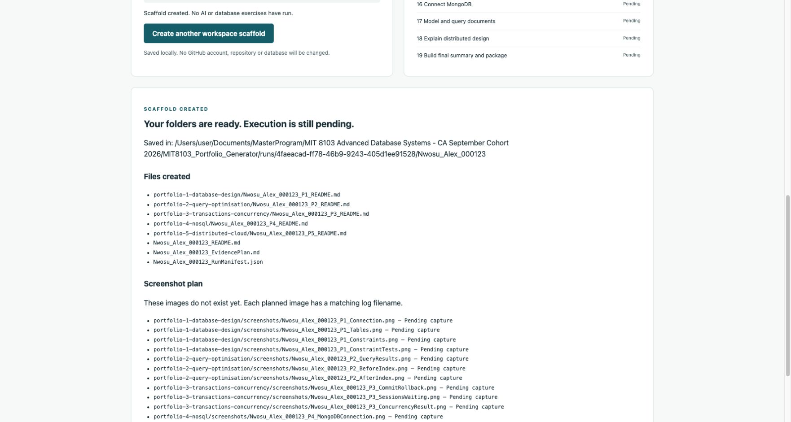

This image documents the scaffold interface. It is not database execution evidence.

The structural-check browser path also accepted the hand-written hospital model (four entities, three relationships). Changing its transaction entity to `not_in_model` produced two visible errors: an unknown entity and a mismatch with its concurrency rule. This was a proposed-model check, not a live database run.

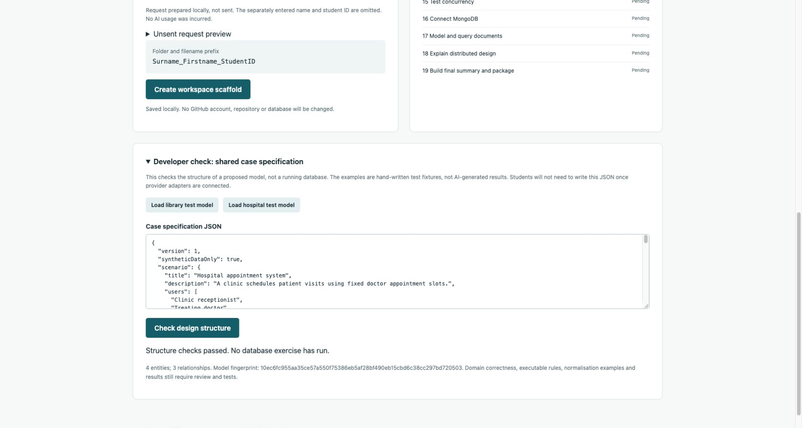

The provider browser check selected Gemini for a fictional hospital scenario. It reported that the local command was found but authentication and quota were not checked. Previewing the request then reported that it was prepared locally and not sent. No executable was launched and no model usage was incurred.

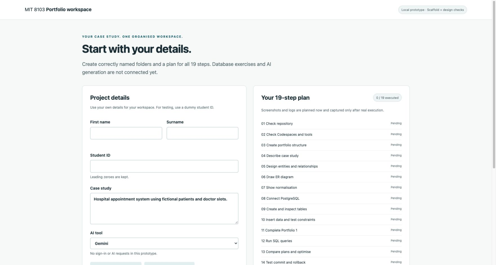

## Not verified or built yet

Gemini/Codex authentication and generation; unrestricted-case SQL execution beyond the supported model profile; automatic screenshot capture; PDF generation; package download; student submission. The form's screenshot feature still creates a plan only. Pilot screenshots were captured separately with browser tooling. Readiness checks and prompt previews must not be confused with connected provider execution.

## Live Copilot attempts

Copilot CLI 1.0.103 was installed locally and used with the explicitly selected GitHub account `arizonal2014`. The fictional case concerns patients, doctors, appointment slots and bookings. No student identity fields were included in the case prompt.

- `copilot-probe-8a83ffe6-713f-4bfa-b499-6a80ea430f48`: the CLI rejected a credit ceiling of 1; its minimum is 30. No response was generated. This early report's `submitted: true` was inaccurate; it records CLI invocation, not a successful submission. Later reports distinguish these states.
- `copilot-probe-853809c9-0311-43f6-a8a3-bc55e4738d13`: the CLI rejected a wildcard tool-denial option before generation.
- `copilot-probe-abb6b440-5d65-408c-8d81-3108c5897a04`: CLI exit 0 and a hospital design returned, but JSON parsing failed on unescaped line breaks. Status `invalid_response`; no downstream execution.
- `copilot-probe-ca6270d4-d29f-49d2-b013-3bba89823b56`: machine-readable output arrived successfully. The first extractor rejected it because the CLI emitted an empty assistant event before its final content. The extractor now ignores empty content events but still rejects multiple non-empty messages or tool requests. Revalidating the saved bytes locally produced valid JSON with four structural errors: one grouped foreign-key rule and three unknown snapshot entity names. `revalidation.json` records the source SHA-256 and confirms no new model request was made during that check. Original `report.json` was preserved.
- `copilot-probe-78a3fe7f-4ee8-4aeb-a136-82db33fbb1e7`: one explicit correction request included the previous specification and actual validation errors. Copilot returned a design that passed the schema and cross-reference checks: four entities (`patient`, `doctor`, `slot`, `booking`) and three relationships. Status `validated`, CLI exit 0, fingerprint `2b8f5da59320f1fb788a093531fabd1e2eb6f890b7fe68e7f4cb6e6365b9ca71`. No tools were requested and no database or publication stage ran. This process had loaded an earlier validator warning that incorrectly said no AI request had run; that wording is now scoped to what the validator itself does. The historical report remains unchanged.

Original local reports and responses remain under ignored `runs/`. The revised probe uses machine-readable JSONL and retains both the envelope and extracted case response. Structural validation alone does not prove domain correctness or database execution.

The passing design needed explicit executable bindings before SQL execution. The next milestone below defines and tests those bindings for this hospital pilot. Descriptions are not executed or treated as SQL.

## Real PostgreSQL pilot

Run `postgres-pilot-8a345806-6f8d-46b3-90f4-5ad0afc25427` passed using the locally available official `postgres:17-alpine` image. Its immutable local image ID, source digest and reviewed model fingerprint are in `Report.json`. The review adds a slot chronology rule and explicit booking-status, cancellation and partial-uniqueness expressions, while retaining the original Copilot model separately.

Actual PostgreSQL catalog checks verified four tables, four primary keys, three foreign keys, one declared unique constraint, two CHECK constraints, one partial unique index and all required columns. Ten attempted invalid records were rejected: duplicate primary key, missing required value, missing doctor/patient/slot links, second active booking, invalid status, cancellation without its time, reversed slot times and duplicate doctor start. A valid sequence retained two cancelled bookings and accepted one active booking for that slot.

Saved artifacts are in the ignored run folder: `SourceCaseSpec.json`, `ReviewedCaseSpec.json`, `ExecutionPlan.json`, `Schema.sql`, `ConstraintTests.sql`, `SchemaExecution.log`, `TablesAndConstraints.log`, `ConstraintTests.log`, `Catalog.json`, `Report.json` and `Evidence.html`. The temporary owned container and its anonymous volumes were removed; no host ports or network were enabled. Other databases were not used.

The image is a browser screenshot of the recorded outputs, not a terminal reconstruction. Screenshot capture is not yet part of the automatic runner. The schema run does not complete Portfolio 1, prove arbitrary-case generation, prevent all overlapping slots or demonstrate concurrent sessions. See [execution details and limits](PostgreSQL_Execution.md).

## Connected browser run

Chrome run `024aa192-665b-4bda-b722-f4c1596172cb` completed with fictional details Alex Nwosu and ID `000123`, using Copilot account `arizonal2014`. The case-selector button filled the explicit hospital pilot scenario. The live model response passed on the first attempt, then the reviewed schema and ten record-rejection tests passed in PostgreSQL. The owned temporary container and anonymous volumes were removed.

The visible form showed all three workflow rows complete, four of nineteen assessment steps complete and two draft steps. Known file links opened the actual SQL, logs, catalog, report, manifest and evidence view. The screenshot below records the completed browser state.

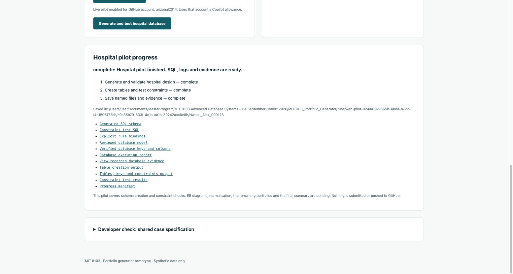

The named output folder is under `runs/web-pilot-024aa192-665b-4bda-b722-f4c1596172cb/e0a35b70-833f-4c1a-aa1b-30242aac6e8b/Nwosu_Alex_000123/`. A screenshot of the database evidence was saved inside its Portfolio 1 `screenshots/` folder and recorded in the manifest/evidence plan as captured by development browser tooling. `ScreenshotCapture.json` records the source URL and image SHA-256. This was not automatic runner capture.

See [the browser workflow guide](Browser_Workflow.md) for account configuration, restart limits and supported scope. The existing codelab was not edited.

## Connected design stages

Browser run `64796a5b-18da-4bb6-836c-eedd76b9419e` completed with fictional Alex Nwosu, ID `000123`, and Copilot account `arizonal2014`. Its first AI response passed, PostgreSQL passed, and the new design-document stage generated six additional named artifacts: ER HTML/SVG/Mermaid and normalisation HTML/Markdown/JSON.

The diagram and normalisation record share reviewed-model fingerprint `a8f37cc781e32a571106283b9f33805b684456c9b9f61c73814ccec67bc11d73`. PostgreSQL now captures complete pilot rows in `Catalog.json.data`. The normalisation check reconstructed all three booking-history rows without changing their values. The browser showed all four workflow rows complete and six of nineteen assessment steps complete; the case/design drafts and Portfolio 1 review were not marked complete.

The ER link rendered all four entities and three relationships. The normalisation link displayed the repeating-group example, 1NF table, expandable unchanged 2NF table and four 3NF tables. The 2NF control was expanded in the browser and checked. SVG/source and Markdown/JSON files are also available through known artifact links.

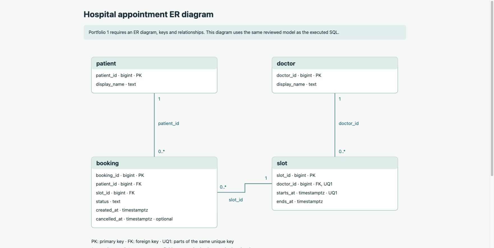

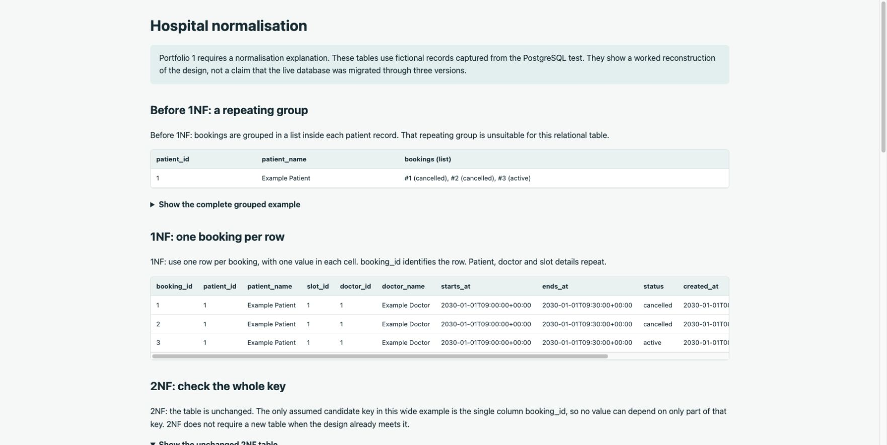

`verification/Normalisation_Reconstruction.jpg` records the final joined-row check. Copies of these development captures are in the run's prefixed Portfolio 1 `screenshots/` folder. `DesignScreenshots.json` records that they were captured by browser tooling; automatic screenshot generation is not implemented.

The run output is under `runs/web-pilot-64796a5b-18da-4bb6-836c-eedd76b9419e/1fc4be50-c715-4971-aa97-a26af322c1e0/Nwosu_Alex_000123/`. The temporary database was removed. The local app is intentionally left running for the user's own test. The published codelab remains unchanged. See [design-stage limits](Design_Artifacts.md).

## Free-text case workflow

The active app now uses `case-workflow.mjs`, `execution-package.mjs`, `postgres-case.mjs` and `case-design.mjs`. Legacy hospital modules remain for regression/history only. The input is free text, with bounded supported model/rule shapes; successful completion is not claimed for all possible descriptions.

### Independent real database checks

- Library fixture run `postgres-case-90b89941-83fc-4371-a783-1aa013bc8ee4`: passed with four tables, three foreign keys, three unique constraints, one CHECK, one partial unique index, five valid rows and thirteen exact-target record rejections. No model call was made for this hand-authored integration fixture.
- Student-enrolment fixture run `postgres-case-00f6623c-4bb1-40d6-8965-d340f34c07ae`: passed with three tables, two foreign keys, one unique constraint, one numeric CHECK, six valid rows and eight exact-target rejections. Its captured records produced two partial-dependency explanations and three 2NF tables. `NormalisationCheck.json` records the sample reconstruction. No model call was made for this hand-authored fixture.

Both used isolated official PostgreSQL containers; the owned containers and anonymous volumes were removed. Catalog snapshots and rejection logs are retained in their ignored run folders. Each negative test checks PostgreSQL's SQLSTATE plus its actual constraint or NOT NULL column name; another failure cannot masquerade as the expected rejection. The runner also verifies that negative tests did not change the valid data.

### Live browser generation with a typed case

Run `0d6f9a71-3e35-407c-b861-8db64170d9d6` used fictional Jamie Cole, ID `000456`, and account `arizonal2014`. A college-library scenario was typed manually; the example button was not used and no hospital/library model template was supplied. Copilot generated the four-entity model `members`, `books`, `copies`, `loans`.

The first model exceeded the NoSQL variable-field count. Its one correction passed. A separate execution-package request passed preflight on its first attempt. Total AI requests: three. PostgreSQL then verified four tables, eight seed rows and thirteen exact constraint-target rejections. The diagram and normalisation were built from the same model and captured records. The model fingerprint is `fe4ec02d5b0e6a5132fc90936f60f4326ecd14bc88bf093b6f7e0ea7f856ccf6`.

The browser showed all five workflow rows complete and eight of nineteen assessment steps complete. The output path is `runs/case-run-0d6f9a71-3e35-407c-b861-8db64170d9d6/2ef5d5e0-d8ab-48fe-acb7-60844730dc56/Cole_Jamie_000456/`. The five primary output links are visible; additional SQL/logs are collapsed to reduce clutter. There are 22 known artifact links.

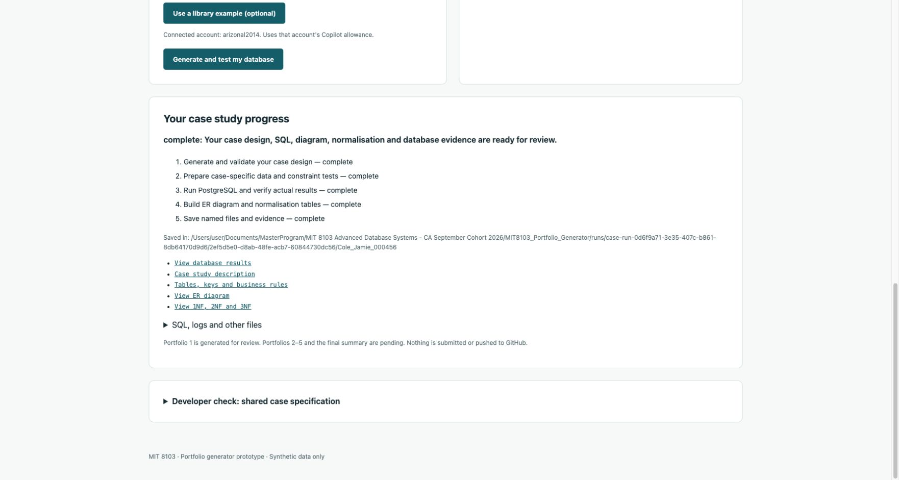

The generated ER page was inspected. An observed line-overlap issue was corrected by routing edges outside table boxes and separating endpoint labels. Only derived diagram files were regenerated; the saved database evidence was unchanged. `DiagramLayoutRevision.json` records that correction.

The generated normalisation page uses the `copies → books` relationship branch for its wide example and lists all four final tables. Both wide rows reconstructed identically. Its required single-column candidate keys leave 2NF unchanged; the separate student-enrolment fixture verifies the composite-key split. The page now identifies minimal declared candidate keys rather than treating redundant superkeys as candidates. Whole-domain dependencies still require individual review.

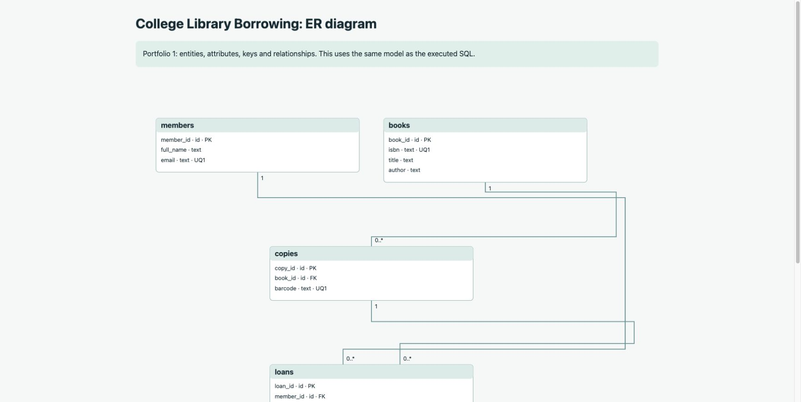

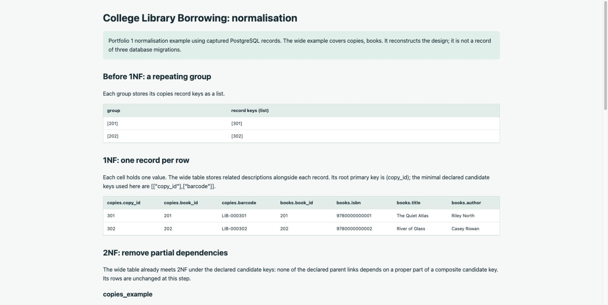

Completed case runs and their known file links were restored after restarting the server. The ER route and completed status were reloaded in Chrome without any new model/database request. Rehydration restricts file paths to the saved run output; interrupted jobs are not rerun automatically.

Development screenshots were saved both in `verification/` and the prefixed Portfolio 1 `screenshots/` folder. `DevelopmentScreenshots.json` records their hashes and that capture was performed by browser tooling, not automatically by the runner. The live server remains on loopback for user testing. This is the complete current Portfolio 1 generation path, not all nineteen steps or a completed assessment submission.

The existing codelab remained at revision `619af2bb8394ad020fc29223acaedf80f3423a61` with a clean working tree after the blueprint work. At that earlier checkpoint the generator was local and unpublished; the later Codespaces milestone below records publication and testing.

## GitHub template and real Codespaces verification — 24 October 2026

The [public generator repository](https://github.com/arizonal2014/MIT8103_Portfolio_Generator) is enabled as a template. The signed-in Chrome account, `harrson2026`, created a separate private copy, [Cole_Jamie_000456](https://github.com/harrson2026/Cole_Jamie_000456), through **Use this template**. All student details in this test are fictional.

Codespace `silver-cod-vpw6jppwqxjvhpjwx` installed dependencies, prepared PostgreSQL and started the app on port 4310 automatically. Node v22.17.0 and Docker 29.9.2-2 were observed. The forwarded app retained private visibility. Copilot used that Codespace account's own GitHub authentication; no local credentials were transferred. All 87 automated tests passed inside the Codespace as well as locally.

A freely typed equipment-rental case completed job `7431420a-bef7-4792-bbd4-24c8d016c37d`. The generated database had three tables, and twenty invalid-record checks were correctly rejected. Evidence reported cleanup of the owned container and anonymous volumes. The generated ER diagram, normalisation, schema, tests and logs were available through the app. This verifies Portfolio 1 execution; later portfolios remained pending.

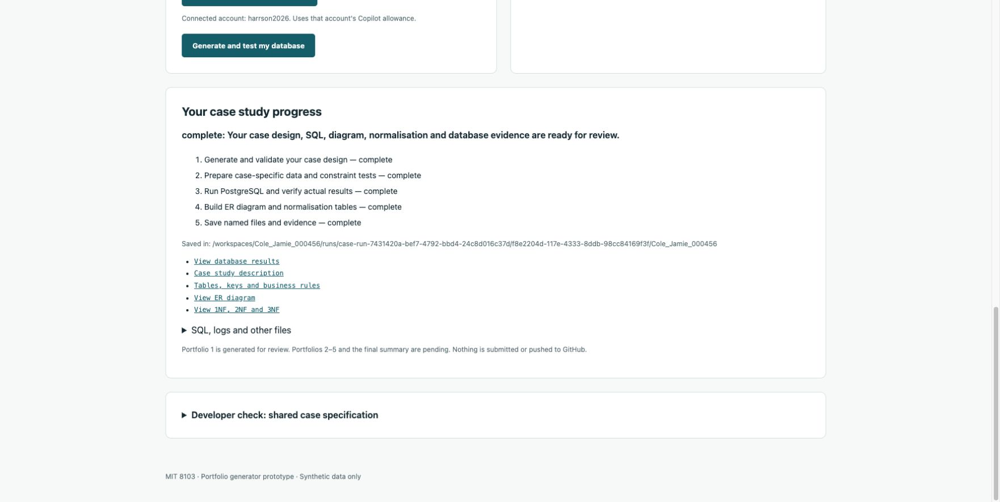

After review, `npm run save` copied only the named output folder, committed the actual checkpoint and pushed it to the private copy. The [saved Portfolio 1 folder](https://github.com/harrson2026/Cole_Jamie_000456/tree/main/Cole_Jamie_000456/portfolio-1-database-design) was verified in Chrome at commit `cf3128e613409d2fe368bc55f1403f3d651b0546`. Ignored run diagnostics and workspace server state were excluded. No historical timestamps were invented.

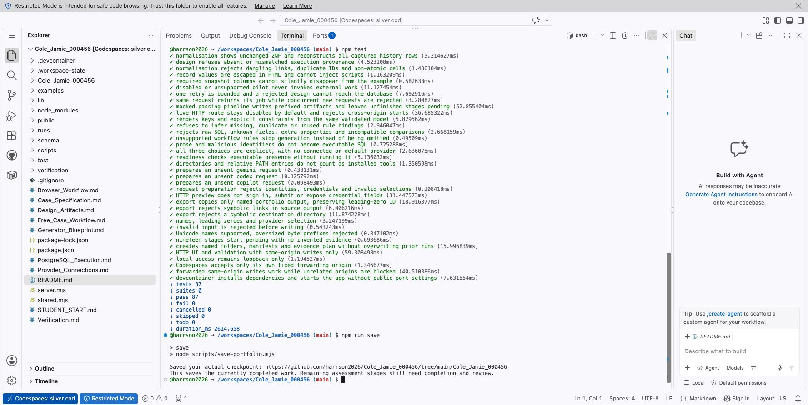

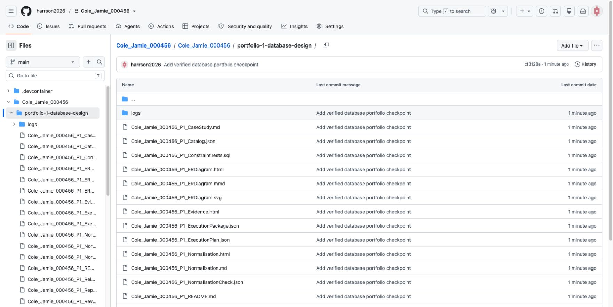

The test copy was created while the save command was still being developed. Its save-command files were fetched from the published template, reviewed and committed before the final test. Fresh template copies already contain these files and need no manual fetch.

Automatic screenshot capture is still pending: the three images above were captured separately through browser tooling. They document this verification run and are not presented as student-captured evidence.

## Portfolio 2 — query processing and optimisation

The app now offers **Run Portfolio 2** after a successful case-generation run. It reuses that run's validated model and execution package, without additional AI calls. The supported exercise produces a join, filter and grouped count from actual case tables, with result rows and JSON `EXPLAIN (ANALYZE, BUFFERS)` output. A separate performance projection copies the selected field's type, generates a bounded synthetic distribution and compares the same lookup before/after a B-tree index. It does not pretend to scale complete business records or retain their constraints.

All 92 automated tests passed locally and in the existing student Codespace. New checks cover case-derived SQL, multiple field types, plan interpretation when indexing is slower or unused, zero timings, restored Portfolio 2 links, failures preserving Portfolio 1, and stage completion only after passing results.

Real local PostgreSQL runs passed for the library fixture (100,000 performance rows), student enrolment fixture (10,000 rows), and the existing freely typed college-library run (20,000 rows). The library fixture initially used the earlier JSON join presentation; later runs use ordinary named result columns for readability. Additional text and integer lookup runs passed after the startup fix described below.

One additional local run stopped because `pg_isready` briefly accepted the image's temporary initialization server, which then shut down before psql connected. Its failed diagnostics are retained under `runs/postgres-queries-67030707-62ab-4078-a8ab-222989321889/`. The readiness check now waits on TCP 127.0.0.1, which that temporary server does not listen on. Subsequent text and integer runs passed (`postgres-queries-2d756808-a387-453f-8c1c-95888a5370a6` and `postgres-queries-a17a7c3a-9669-4b53-b80b-6e64ecb8094a`). The failed run was not turned into passing evidence.

In Chrome, **Run Portfolio 2** completed the existing equipment-rental case in the private student Codespace, job `7431420a-bef7-4792-bbd4-24c8d016c37d`. Three real queries ran. Its `rentals.returned_at` timestamp field was used for a 20,000-row performance projection. The lookup matched 20 rows; before/after rows were identical. Three execution times before indexing were 1.599, 0.992 and 1.556 ms; after indexing they were 0.239, 0.187 and 0.236 ms. Medians were 1.556 and 0.236 ms. The plan changed from sequential scanning to a bitmap index/heap scan. Middle-run shared block counts changed from 112 hits/0 reads to 25 hits/0 reads. Index size was 172,032 bytes. These are observations from this warm-cache run, not promised results for other machines. PostgreSQL removed its owned temporary container and anonymous volumes.

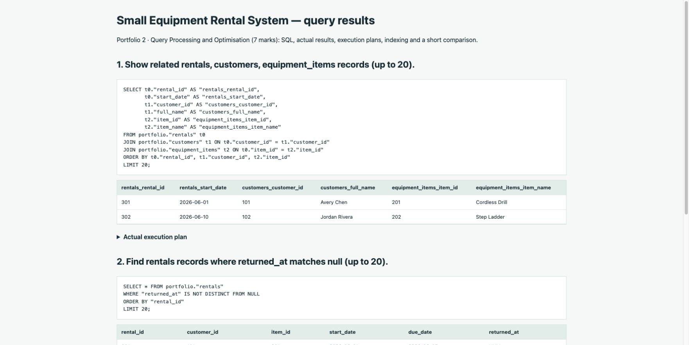

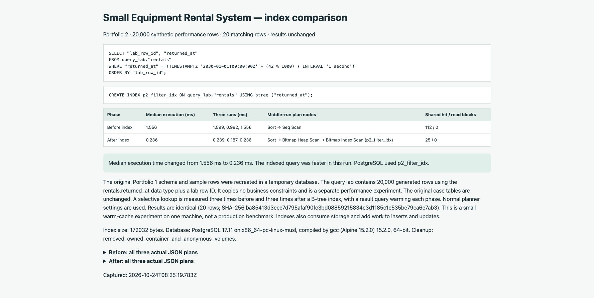

`npm run save` committed and pushed the [Portfolio 2 folder](https://github.com/harrson2026/Cole_Jamie_000456/tree/main/Cole_Jamie_000456/portfolio-2-query-optimisation) at `18cef73377feddc35e9ca17f4dfba3a15a0a1580`. The two real browser captures were then added under its `screenshots/` folder and committed at `cb5df57e99e13605e8350de6afe85a5d0c0fe358`. The test-copy screenshot records explicitly identify these as separate browser captures during verification. They are not an automatic screenshot feature. Browser file upload required an additional extension permission, so the captured image bytes were placed through the Codespace terminal without changing that permission.

Steps 12 and 13 are complete for these passing runs; Portfolio 1 individual review and Portfolios 3–5 remain pending. Failures show an error and permit an explicit retry. Saved links survive a server restart; a previously running query experiment is marked interrupted and not silently rerun.

## Portfolio 3 — transactions and actual concurrent sessions

Portfolio 3 reuses the saved case model and execution package without another AI request. It recreates the schema and rows in an isolated PostgreSQL container, selects the model's transaction entity and a saved row, and adds a temporary processing counter. The helper is clearly distinguished from the Portfolio 1 design and original business columns. The implemented method is row locking, even if the original model proposed another method; the report records both rather than claiming that the proposed business operation was implemented.

All 99 automated tests passed locally and in the student Codespace. Additional tests cover case-specific row selection, ignoring operation prose as SQL, helper-name collisions, rejection of leaked/uncommitted updates and incorrect rollback/blocking results, distinct sessions and actual isolation, escaped evidence, restored artifact links, preservation of earlier portfolios, interrupted runs, and refusing an export while transactions are running.

Real local PostgreSQL fixture runs passed for library borrowing (`postgres-transactions-da464a62-a6d4-4c4d-9850-efb1ea768cb5`) and student enrolment (`postgres-transactions-f52fdb1d-da78-4220-b782-b02eb9f4622c`). An earlier enrolment attempt (`postgres-transactions-71244e29-b58e-4614-a146-49d6573bf536`) stopped because the stdout completion marker arrived before separate stderr text containing the expected constraint name. The session launcher now merges psql's diagnostic output into its ordered output stream before applying completion markers. The failed attempt remains retained and was not marked as passing evidence.

The local Chrome button also completed the existing freely typed college-library run, job `0d6f9a71-3e35-407c-b861-8db64170d9d6`, selecting `loans.loan_id=401`. Its actual run was `postgres-transactions-dbe3c50d-6105-4715-b624-f47164425179`. COMMIT preserved 1; another session saw 0 while that update was uncommitted. The later in-transaction value 11 was rolled back to 1 after CHECK failure 23514 and aborted-transaction state 25P02. The stale-read experiment finished at 2; locking before reading finished at 3. PostgreSQL reported session 125 waiting on session 126 with Lock/transactionid. All original case columns were checked unchanged. Owned containers and anonymous volumes were removed.

In the private student Codespace, Chrome's **Run Portfolio 3** completed job `7431420a-bef7-4792-bbd4-24c8d016c37d`, selecting `rentals.rental_id=301`. The report completed at `2026-10-24T08:43:05.832Z`. COMMIT/rollback and visibility values matched the checks above. Session B (115) was observed waiting for Session A (116), with Lock/transactionid. Both used READ COMMITTED. The stale-read experiment finished at 2, and locking before reading finished at 3. All original case columns were verified unchanged and the owned container/volumes were removed.

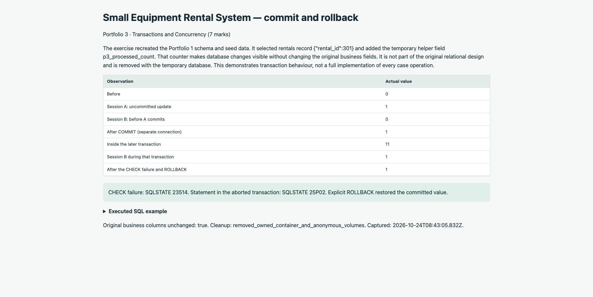

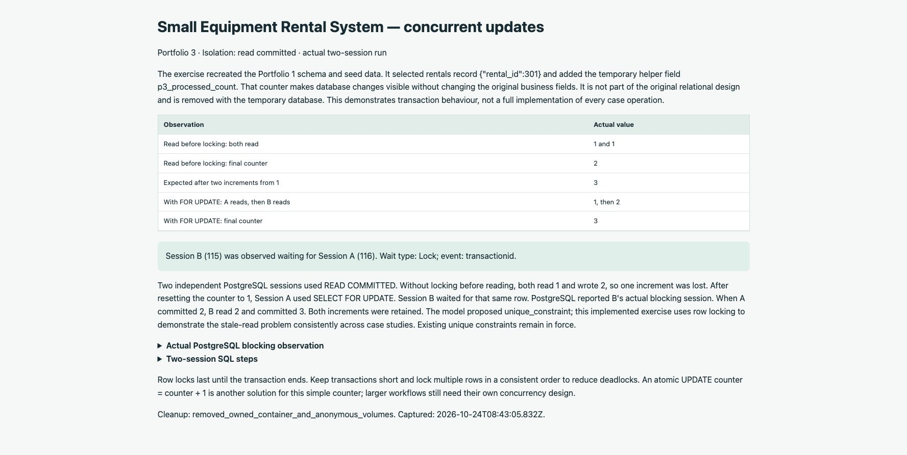

The two images were captured separately through browser tooling and placed in the run's named Portfolio 3 `screenshots/` folder. Their SHA-256 values and captured status were recorded in the evidence manifest. This is verification capture, not an automatic screenshot feature. `npm run save` exported the SQL, reports, both session logs, explanations and screenshots, then pushed the [private Portfolio 3 folder](https://github.com/harrson2026/Cole_Jamie_000456/tree/main/Cole_Jamie_000456/portfolio-3-transactions-concurrency) at real checkpoint `53d5d95612ef410c330787d4dc5c2c4135203b5c`. The GitHub folder and screenshot entries were checked in Chrome.

Steps 14 and 15 are complete for these passing runs. Portfolios 4 and 5, automatic screenshots, the final summary and individual review remain pending. No assessment was submitted.

## Portfolio 4 — MongoDB document modelling and queries

The app's **Run Portfolio 4** reuses the saved case and valid synthetic records without another model request. It selects a source record that links to the declared NoSQL sources, matches related records through actual saved keys, and builds two illustrative event types. Embedded snapshots, external source-key references, flexible details and native event Dates are documented. Events are explicitly labelled `simulation: true`; their sequence and sample timestamps are not inferred business history. The explanation distinguishes imported JSON snapshot dates from the BSON event timestamp.

The generated executable mongosh script creates a fresh collection with strict core-field validation, inserts the sample documents, adds a type/time index, runs four queries and verifies two expected rejections. The Node verifier independently compares all stored documents and query rows to the planned examples. Invalid date type 121 and duplicate event ID 11000 must both be observed, and stored data must remain unchanged. Index creation is verified without claiming a performance improvement. The script can also be replayed manually with a supplied Atlas/other MongoDB connection; the app's automatic route uses its own isolated container.

All 109 automated tests passed locally and in the existing student Codespace. New tests cover related-row matching, disconnected source plans, variable metadata, script syntax and data quoting, executable Date filters, equivalent Extended JSON Date formatting, rejection of changed dates/types/data/results, strict validation, restored file links, preserving earlier portfolios, JS-file export, and interrupted/running-run guards.

Two local fixture runs passed with MongoDB 7.0.43: library borrowing `mongo-documents-de4052ab-ff93-4b81-a666-b2c96fde8562` and student enrolment `mongo-documents-6f24e794-f8bb-4d6a-b117-b574d810514c`. Each inserted four documents, verified four query outputs and observed both expected rejection codes. Containers and anonymous volumes were removed.

The initial local MongoDB 8.0 runs stopped at startup. A separate owned-container diagnostic identified the Docker kernel as `7.0.12-linuxkit`; the cached MongoDB 8 binary refused that kernel because of the [vendor-documented kernel/TCMalloc incompatibility](https://www.mongodb.com/docs/v8.0/release-notes/8.0/). The new lab standardises on MongoDB 7.0 for both local and Codespaces execution. No host kernel or existing database was changed. Initial failed run IDs were `mongo-documents-ab3887f2-e3e1-46c3-9f6f-5d78160f427d` and `mongo-documents-57d773a0-82c0-4e89-b7df-7ef82b42c0fc`. The runner now retains its owned server log and detects a stopped container early.

Intermediate script/check failures were also retained: unsupported top-level await in a mongosh script (fixed by an async wrapper), mongosh's insert response exposing inserted IDs rather than an insertedCount property (now verified using acknowledged IDs), and relaxed Extended JSON omitting zero milliseconds (now compared as exact Date instants while retaining raw output). These attempts were not marked as passing evidence. The new script syntax and Date-format regression tests cover these boundaries.

The local Chrome button completed the existing freely typed college-library case, job `0d6f9a71-3e35-407c-b861-8db64170d9d6`, at `2026-10-24T09:04:10.685Z`. Four inserted documents, four query results, both rejections and the unchanged stored documents passed. Steps 16 and 17 were completed only after these checks.

The Codespaces browser run completed job `7431420a-bef7-4792-bbd4-24c8d016c37d` at `2026-10-24T09:07:25.454Z` with MongoDB **7.0.45**. Its `rental_events` collection contained four documents derived from the two saved rental records and linked customer/equipment snapshots. Queries by event type, nested source key, time range and grouped event counts returned 2, 2, 4 and 2 rows respectively. Both expected rejection codes were observed, all stored documents matched, and `_id_`/`event_type_time` indexes were verified. The owned container and anonymous volumes were removed.

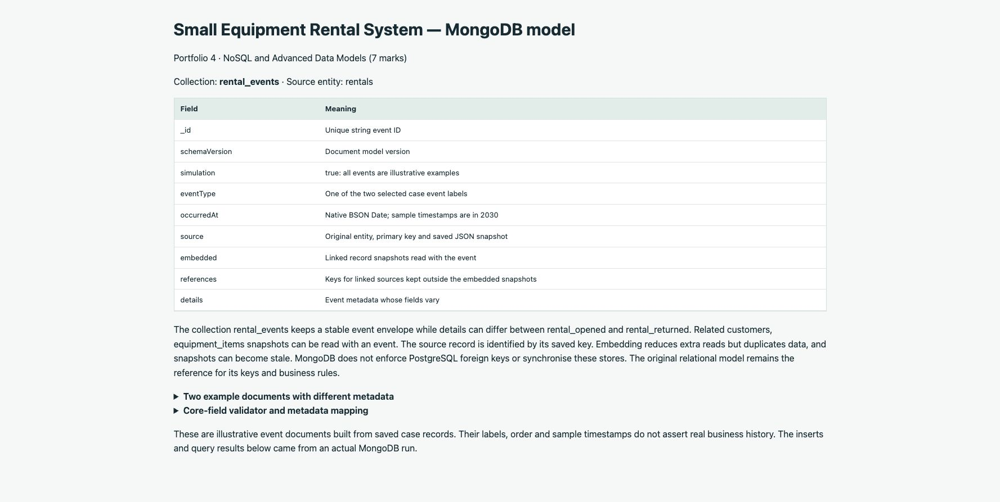

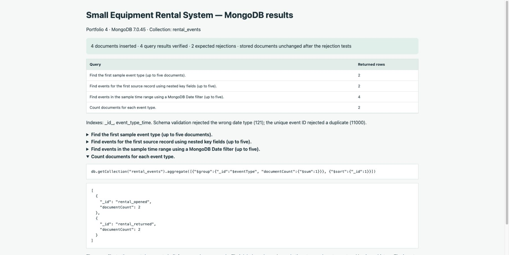

The two images were captured separately using browser tooling and placed in the named Portfolio 4 `screenshots/` folder. Captured status and image SHA-256 values were recorded in the evidence manifest. This is verification capture; automatic screenshot capture remains pending. `npm run save` exported the documents, model, executable JS script, actual results, logs, explanation and images, then pushed [the private Portfolio 4 folder](https://github.com/harrson2026/Cole_Jamie_000456/tree/main/Cole_Jamie_000456/portfolio-4-nosql) at real checkpoint `cc7a3b3416edaf6f6edb8ad3be43ccc9d13ecb53`. The file and screenshot listings were checked in Chrome. The two patch versions tested locally/in Codespaces both passed the same data checks.

Atlas connectivity was not tested and is not an automatic app adapter. The exported mongosh script is connection-neutral and the guide documents manual replay in a fresh database. Portfolio 5, automatic screenshot capture, the final summary and individual review remain pending. No assessment was submitted.

## Guided completion and final exports — 24 October 2026

The saved college-library case completed Portfolio 5's discussion route, seven automatic report-image captures and a three-page PDF/ZIP export. All three PDF pages were rasterised and inspected, including the ER diagram. Review was exercised with explicitly fictional verification text. The original database results and six measured plans remain the sources of the summary; no live replication experiment or personal student experience is invented.

118 automated checks pass, including final-file allowlists, ZIP symlink rejection, missing review, failed-stage retention and restart/resume state. The renderer uses a fresh Chromium context with JavaScript disabled and network requests blocked. Screenshot provenance records both source and image SHA-256 hashes. Codespaces verification follows below after execution; local output is not claimed as cloud proof.

### Final Codespaces and fresh-case checks

The private `harrson2026/Cole_Jamie_000456` Codespace installed the renderer through `npm run setup:workspace`, completed the equipment-rental discussion/export/review flow and showed **19/19** complete. Its ZIP was downloaded through Chrome, then inspected: **89 files, 3 PDF pages and 7 captured images**; every image SHA-256 matched the manifest. All three cloud PDF pages were visually inspected. Reflection text is explicitly marked as a fictional verification run. The portfolio and real checkpoints were pushed to that private repository. Restarting its server preserved the completed state and links. **119 tests passed in Codespaces and locally.**

A fresh, freely entered **College Course Enrolment** case (`ae233e2c-64c6-4df6-b150-2e5d1039cab5`, fictional `Morgan_Alex_000789`) ran the entire guided pipeline locally through the browser: four tables, 13 expected constraint rejections, all three later database portfolios, Portfolio 5, seven screenshots and final review/export. One case-model correction was needed; the corrected model and execution package validated. A new browser tab reconnected after a server restart without another AI request. Local template-repository verification correctly remains pending; the private Codespace supplies the separate GitHub-save verification.

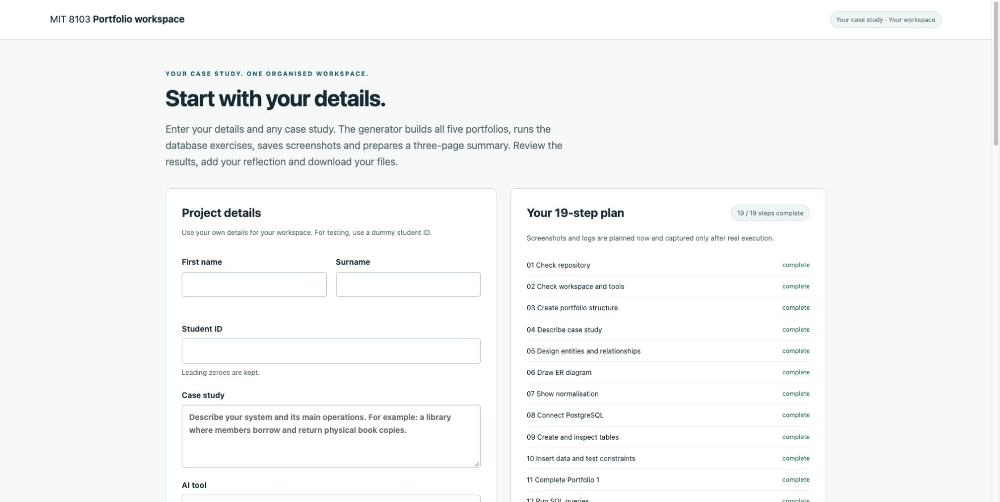

## Minimal interface redesign — 24 October 2026

Replaced the two-column prototype with three disclosed steps: Your details, Build, Review & download. The app uses unmodified, locally hosted IBM Plex Sans and Mono fonts from IBM's official repository, with the SIL Open Font License retained. Settings, the 19-step breakdown, portfolio reports and technical files remain collapsed until opened.

Browser checks covered required-field errors, a garden-case preview with a leading-zero student ID, navigation back to the saved course-enrolment results, grouped ER/normalisation links and a real PDF/ZIP rebuild. The review spinner was visibly active during that export. No new AI request or database exercise was needed for these interface checks. No browser console errors were observed. Widths 375, 768 and 1280px had no horizontal overflow; body and input text were 17px and IBM Plex Sans was loaded. Reduced-motion CSS disables animation while retaining status text. All 119 existing tests passed; the HTTP integration check now also verifies font MIME/signature and rejects unknown font paths.

## Three-step repository pipeline — 24 October 2026

Replaced the template-copy export with a separate private assessment repository. The app captures four fields, creates `Surname_Firstname_StudentID`, runs seven visible stages and pushes a descriptive commit after each completed stage. The five portfolio folders are at the repository root. A conventional `README.md` displays the overview on GitHub; the named README is retained for the correctly named download package. Generator sources, credentials and AI diagnostic files stay out of the assessment repository.

Browser pilot: fictional Robin Hart, ID `000246`, freely entered **Community garden plot allocation**. GitHub account `arizonal2014`; private output [Hart_Robin_000246](https://github.com/arizonal2014/Hart_Robin_000246). Job `445144f0-c3ba-4416-a8d4-2d74aafe99aa`. Two model attempts and two execution-package attempts were used; validation failures were retained and corrected before execution.

- PostgreSQL: three tables, two foreign keys, three checks, one partial unique index and 12 expected record rejections.
- Portfolio 2: three queries, 20,000 performance rows, six measured plans and matching before/after lookup results.
- Portfolio 3: actual commit, rollback, isolation, lost update and row-lock blocking checks passed in distinct sessions.
- Portfolio 4: four MongoDB documents, four verified queries and two expected rejections.
- Portfolio 5: proposed distributed architecture and discussion, accurately labelled as a proposal.
- Seven report screenshots and all three PDF pages were verified to contain only grey RGB pixels. Evidence source and image hashes matched the manifest. The PDF embeds IBM Plex Sans and has three pages.
- The ZIP was downloaded using Chrome and contains 84 named files, including the editable Markdown summary and seven images.
- Seven genuine stage commits were pushed. An eighth correction added the visible GitHub README. The browser confirmed the private repository, root folders, overview and eight-commit history. No timestamps were changed.
- Refresh during generation and a server restart after completion restored the same job without another AI call.
- 126 automated tests passed, including real local Git repository creation/commits, name collisions, symlink rejection, remote student-edit protection, initial-run retry, checkpoint ordering and restart restoration. Test GitHub calls are mocked; the browser pilot used real GitHub and actual databases.

Proof: [completed pipeline](verification/ThreeStep_Pipeline.jpg), [completion view](verification/ThreeStep_Complete.jpg), [repository](verification/ThreeStep_Repository.jpg).

Generation no longer waits for a reflection form. The editable summary contains an individual-reflection section for the student to complete. `packageReady` and completion of the generator do not assert that the student's final reflection or academic submission has been completed.

The new GitHub device sign-in supports the additional repository-creation access needed by Codespaces. This pilot used the existing local GitHub CLI credential; a fresh Codespaces OAuth authorization has not been completed in this verification run. Each student must approve their own access on GitHub. The prior Codespaces checks above remain historical evidence of the database runtime, rather than a claim of a new cloud sign-in test.

The new sign-in helper was also exercised against GitHub's real device endpoint in a temporary isolated configuration. It returned the expected device-code format and GitHub code-entry URL. The process was then cancelled without granting authorization or storing a new token. This verifies the sign-in launch and parsing, while leaving each student's actual consent to them.

## Clean assessment export — 24 October 2026

Checked the submission contents against the assessment brief's five activities and final-document requirements, and compared the presentation with the manual library reference. The exported package now has **28 files** rather than 84. It retains the case description, relational schema, keys and constraints, ER diagram, worked normalisation, executable SQL/JavaScript, actual query and transaction results, all six measured plans, MongoDB model/results, distributed-database discussion, references and AI declaration. Seven result images and one ER image are included. The editable summary and PDF share the same content; the PDF has three pages.

JSON diagnostics, raw logs, HTML reports, fingerprints, timestamp captions, duplicate declarations and separate review templates are not published or zipped. Original execution records and capture hashes remain in the ignored workspace for verification and retries. Result images show measured values as report pages; they are not presented as photographs of a manual terminal session. Portfolio 5 remains a proposal, not a claimed deployment. The case-specific reflection is a technical starting point for the student to review and personalise; the declaration accurately identifies automated execution.

The new Mermaid renderer loads the locally hosted IBM Plex font before measuring text. This fixed clipping of the key and attribute labels. Actual garden, library and hospital diagrams were rendered and visually checked. The summary's PNG, GitHub image and source Mermaid agree. All three final PDF pages were rasterised and inspected, with no clipped diagram text or overflowing content.

All **136 automated tests passed**, including exact export contents, unexpected-file and symlink rejection, safe Markdown rendering, readable SQL, two-session ordering, plan evidence, summary facts, normal Git cleanup commits, restart restoration and protection of remote student edits. `git diff --check` passed. Dependency auditing reported zero known vulnerabilities.

The clean scripts were also replayed in fresh, owned PostgreSQL and MongoDB containers. Schema/sample data, 12 expected constraint rejections, three queries, six plans, commit/rollback, two-session blocking with final counter 3, four MongoDB documents, four queries, and rejection codes 121/11000 all passed. The temporary containers were removed. This replay used the scripts destined for submission rather than the private machine-readable execution harness.

The existing fictional garden run (`445144f0-c3ba-4416-a8d4-2d74aafe99aa`) was rebuilt from its saved successful results, without new AI or database calls. Normal cleanup commits were pushed to [Hart_Robin_000246](https://github.com/arizonal2014/Hart_Robin_000246), retaining its real prior history. The current private repository contains 28 files and 12 genuine commits. The published tree contains no JSON, HTML or log files.

Chrome verified the root folders, summary and loaded ER image (natural width 1614 pixels). The app's **Portfolio ZIP** download produced 28 files and eight PNGs, with no forbidden diagnostics. Its SHA-256 matched the current generated archive. The local app was left open for review. This cleanup did not retest fresh Codespaces OAuth consent; earlier cloud-runtime verification remains separate.

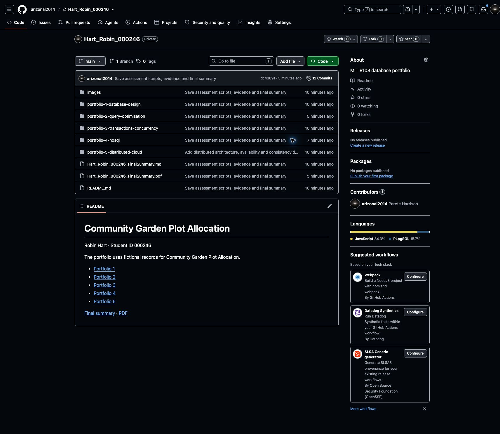

## Preflight and recovery — 24 October 2026

The existing three-step interface now runs a preflight check before creating a repository or contacting Copilot. It validates identity and GitHub-compatible naming, checks case wording, inspects the signed-in account's repository, and checks Docker and the same bundled Copilot executable used by generation. No model request is used for preflight. Authentication and allowance are still verified during the actual provider request, not inferred from an installed command.

Wording checks offer explicit corrections for common misspellings such as `Libary borrowing sytem`, ask for a subject for `Management system`, and reject obvious placeholder/numeric/punctuation input. Students can accept a correction or keep their original wording. Unfamiliar free-text domains remain supported; these are conservative wording checks, not proof of domain correctness or a guarantee that every possible model can be executed. The existing structural and database checks still gate completion.

Repository inspection is read-only. An empty private repository can be adopted; existing populated, public or archived repositories are protected. A matching saved run offers its original case description and a return button. A repository found without its local run offers an open link and guidance to return to the original Codespace. No student ID is changed to escape a collision. A deleted Codespace cannot be reconstructed from the clean assessment files alone.

The initial repository checkpoint and run inputs are retained in private workspace recovery records before model generation. Atomic recovery records survive an initial startup failure, and the browser retains the same pending request ID across a lost start response. Retries preserve completed stages, reuse unpushed commits, and check account/remote state before further execution. An interrupted setup commit can be completed without overwriting retained setup text. A failed initial design can be clarified and retried in the same repository; that option is disabled after Portfolio 1 succeeds. Provider failures surface short categories for allowance, sign-in and connection errors rather than raw private diagnostics.

**164 tests passed.** The new checks cover case wording, unsupported repository naming, ready/missing runtimes, same-origin preflight HTTP handling, direct start-route enforcement, existing/empty/public/archived/unreadable repositories, initial and later failures, restart restoration, lost responses, concurrent starts/retries, account changes, a deleted remote, interrupted commits/pushes, and case revision restrictions. Local Git tests use real repositories with simulated GitHub/transport failures. Model/database stages are mocked in the new failure tests; earlier actual database verification is recorded above. `git diff --check` passed.

Chrome checked the actual local app against the existing public library reference and private fictional garden repository. Vague-case guidance and spelling suggestions displayed correctly. Accepting the library suggestion stopped at the protected existing repository. Entering the garden identity found its saved completed run, and **Open saved result** returned to the same 12-commit result without regeneration. No repository was created or modified by these browser checks.

Separate controlled UI servers on loopback simulated a later-stage failure and an initial startup failure. Refresh restored the paused view; retry reached completion while retaining earlier checkpoints. **Edit case study → Retry with revised case study** also completed in the original simulated repository. These UI fixtures made no AI, GitHub-write or database requests and are not practical database evidence. No browser JavaScript errors were observed in the revision flow. The controlled tabs and servers were closed after verification; the real app remains available on port 4310.

Proof: [wording suggestion](verification/Preflight_Case_Suggestion.jpg), [existing repository protection](verification/Preflight_Existing_Repository.jpg), [controlled failure UI](verification/Recovery_Controlled_Failure.jpg).

## Copilot policy-denial recovery — 25 October 2026

A student supplied the actual `Access denied by policy settings` diagnostic. The previous error classifier incorrectly mapped policy denials and HTTP 403 responses to a sign-in failure. Comparing the last update with its parent showed identical authentication and Copilot request settings; a controlled replay failed in both versions but the update introduced the misleading reconnect message. This comparison does not establish when or why GitHub denied the student's account access.

Policy/license/forbidden responses now show an access-denial message, a link to Copilot settings, and instructions to check the same account's plan and managed CLI access before retrying. Reconnect and case-edit controls are hidden for this category. Rejected credentials, allowance limits, connection failures and timeouts retain separate guidance. No sign-in scopes, credentials, model requests or dependency versions were changed.

On restart, older failures are reclassified from existing private Copilot reports and diagnostics. Original diagnostic files and workflow records are retained; no model request or repository write is triggered by recovery. Missing, oversized or linked diagnostic files produce neutral guidance rather than an invented cause. A newer successful report is not replaced with an older failure. The guided failure message cannot be replaced with the message from an unrelated successful stage.

**173 automated tests passed**, including nine new regression tests. Four of the initial regression tests failed before the implementation. Coverage includes the supplied policy-error pattern, generic 403, licence denials, 401 credentials, 403 rate limits, network errors, redaction, legacy restart restoration, safe diagnostic reading, and an HTTP retry sequence that retains the original run ID, repository and checkpoint. The sequence stays failed while simulated access is denied, then completes after simulated restoration without creating a second repository. Model calls, database execution and GitHub writes are fixtures in this recovery test, not live service verification. `git diff --check` passed.

Chrome verified the actual UI against a separate controlled local server: the Copilot settings URL was correct, reconnect and case-edit buttons were hidden, retry while denied retained the pause, and retry after simulated access restoration reached completion in the same repository with seven checkpoints. Browser testing also exposed and verified a fix for a stale pending-start record overriding a selected saved run after refresh. No browser console errors were recorded. The controlled tab and server were closed. The student's actual account access has not been changed or independently retested.

The [student guide](STUDENT_START.md#continue-after-a-copilot-access-error) explains updating and reopening the same Codespace and retrying the existing run. The fix improves diagnosis and recovery; it cannot grant Copilot entitlement or change organisation policy.

Proof: [controlled policy-recovery screen](verification/Copilot_Policy_Recovery.jpg).
